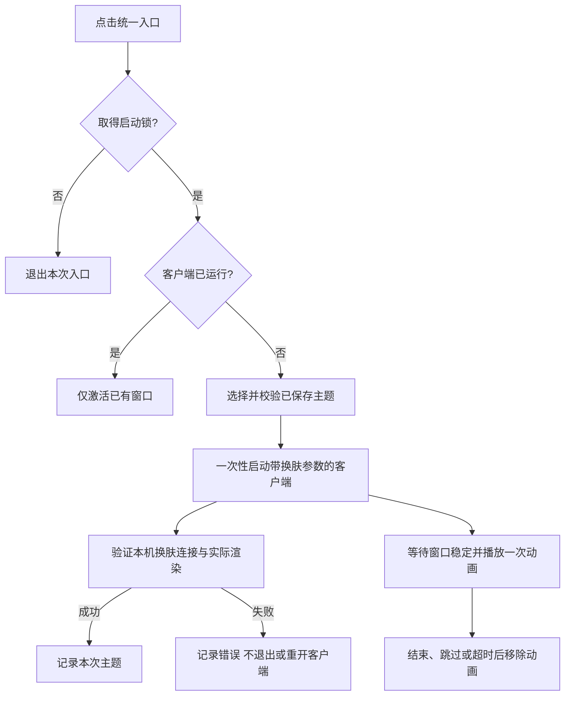

# 配置与行为

两平台均使用含三个字段的 JSON：

| 字段 | 内容 |
| --- | --- |
| `engineRoot` | 已安装 Dream Skin 的根目录，下面必须有 `scripts` |
| `video` | 用户自己的本地视频路径；空字符串跳过动画 |
| `themeIDs` | 非空数组，列出通过 Dream Skin 导入器保存的兼容主题 ID |

macOS 支持路径开头的 `~`；Windows 支持 `%LOCALAPPDATA%`、`%USERPROFILE%` 等环境变量。不要将包含用户名的实际配置提交到 GitHub，示例配置只含占位符。

随机选择去重后的 ID；有两款以上时排除上次验证成功的 ID。只有一款时仍可使用。缺失主题会报错，不悄悄随机改选另一款。

## 状态流程

锁覆盖启动和皮肤验证阶段。应用自身更新、系统重启、外部启动器同时操作，不在本入口的单实例保证范围内。

媒体缺失/损坏时继续启动换肤。主题或依赖预检失败时不会启动；启动后的 CDP/渲染失败保留客户端并提示。这是有意设计的失败路径，不会自动回退到无皮肤的第二次启动。
